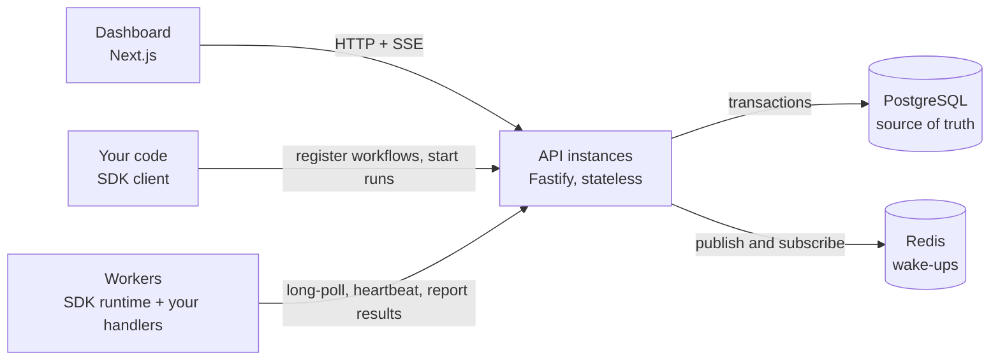

# FlowForge

[](https://github.com/Jithendranath8/FlowForge/actions/workflows/ci.yml)
[](LICENSE)

FlowForge is a distributed workflow orchestrator. You describe a workflow as a directed acyclic graph (DAG) of tasks, start runs of it through an HTTP API, and run your own worker processes. FlowForge decides which tasks can run next, leases each one to a worker, retries failures, and records every state change in PostgreSQL. If a worker crashes mid-task, the work moves to another worker without losing or double-recording results.

**Status: v1.0.0, a working prototype.** The engine, API, SDK, dashboard and observability stack are complete and tested locally and in CI. The packages are not published to npm, and FlowForge has not yet been verified against hosted PostgreSQL and Redis.

## Features

- **DAG workflows.** Definitions are plain data and versioned: changing one creates a new immutable version. Tasks have dependencies, trigger rules (`all_succeeded`, `all_done`, `any_failed`), retries with exponential backoff and jitter, timeouts, queues, priorities and required capabilities.
- **Crash-safe execution.** A worker holds a time-limited lease on each task and renews it with heartbeats. Every result carries a fencing token, so a worker that lost its lease cannot overwrite newer work. Handlers can save checkpoints that the next attempt receives, and tasks that fail for good become dead letters. Handlers run at least once; each task's result is recorded exactly once.
- **Fair scheduling.** Tasks are ordered by priority plus an aging bonus, limited per run and per workspace, and matched to each worker's free slots, CPU and memory. When runs tie, the one with fewer running tasks goes first, so one large run cannot starve the rest.
- **PostgreSQL as the source of truth.** The API is stateless; run as many instances as you like. A claim is a guarded update under the run's row lock, and each state change commits in the same transaction as its event. Redis only delivers wake-ups: if it is down, workers fall back to polling.
- **Multi-tenant.** Workspaces have scoped API keys and quotas enforced under a row lock. People sign in to the dashboard with Google or GitHub (OAuth 2.0 with PKCE), with server-side sessions, CSRF tokens, roles and an email allowlist.
- **Live dashboard.** A Next.js app shows runs, task attempts, workers, scheduling decisions and history, updated live over Server-Sent Events.
- **Operations.**
  - Prometheus metrics on a separate listener.
  - OpenTelemetry tracing, one trace per run.
  - A provisioned Grafana dashboard.
  - Alert rules with promtool unit tests.
  - Data retention.
  - A `flowforge-admin` CLI to manage workspaces, API keys, quotas, members and sessions, and to check a deployment's PostgreSQL and Redis.
- **Safe startup migrations.** Migrations run under a transaction-scoped advisory lock with a bounded wait, so several instances can start at once, including through a transaction-mode pooler such as PgBouncer.

## Architecture



The API never runs your code. Workers are your own processes built with the TypeScript SDK. Each worker declares the task types it handles and its capacity, and long-polls the API for work.

A run proceeds like this:

1. You register a workflow. An unchanged definition returns the existing version.
2. You start a run, optionally with an idempotency key: repeating the key returns the original run.
3. Tasks whose dependencies are satisfied are queued. A polling worker gets a lease on one.
4. The worker runs the handler and reports the output or the error. The report counts only if it carries the current fencing token.
5. Failed attempts are retried with backoff up to the task's limit. When every task is finished, the run ends.

## Example

A workflow is plain data:

```ts
import { defineWorkflow } from "@flowforge/sdk";

export const dailyReport = defineWorkflow({
  name: "daily-report",
  tasks: [
    { key: "extract", type: "orders.extract", retry: { maxAttempts: 3, initialDelayMs: 500, maxDelayMs: 5_000, backoffCoefficient: 2, jitter: 0.2 } },
    { key: "clean", type: "orders.clean", dependsOn: ["extract"] },
    { key: "enrich", type: "orders.enrich", dependsOn: ["extract"] },
    { key: "load", type: "report.load", dependsOn: ["clean", "enrich"], timeoutMs: 60_000 },
    { key: "notify", type: "report.notify", dependsOn: ["extract"], triggerRule: "any_failed" },
  ],
});
```

A worker implements the task types:

```ts
import { createWorker } from "@flowforge/sdk";

const worker = createWorker({
  apiUrl: "http://localhost:4000",
  apiKey: process.env.FLOWFORGE_API_KEY ?? "",
  concurrency: 4,
  handleSignals: true, // on SIGTERM: finish in-flight tasks, then deregister
  handlers: {
    "orders.extract": async ({ runInput }) => ({ day: runInput.day, orders: [] }),
    "report.load": async ({ idempotencyKey }) => ({ reportId: idempotencyKey }),
    // ...
  },
});

await worker.start();
```

The complete example is in [examples/quickstart](examples/quickstart).

## Quick start

You need Node.js 22 or later and Docker.

```sh
git clone https://github.com/Jithendranath8/FlowForge.git
cd FlowForge
npm ci
npm run build

docker compose up -d --wait   # PostgreSQL 16 and Redis 7

cp .env.example .env
node -e "console.log('SESSION_SECRET=' + require('crypto').randomBytes(48).toString('base64url'))" >> .env

npm run dev:api               # API on http://localhost:4000; migrations run on start
```

In a second terminal, create a workspace and two API keys (each key is printed once), then start a worker:

```sh
npm run admin -- create-tenant demo
npm run admin -- create-key demo cli read,workflows:write,runs:write
npm run admin -- create-key demo worker worker

FLOWFORGE_API_KEY=<worker key> npm run worker -w @flowforge/example-quickstart
```

In a third terminal, run the workflow:

```sh
FLOWFORGE_API_KEY=<cli key> npm run run-workflow -w @flowforge/example-quickstart
```

To see recovery, kill the worker with `kill -9` during a run and start it again: its tasks are re-leased once their leases expire, each with a new fencing token.

The dashboard runs with `npm run dev -w @flowforge/web` on http://localhost:3000. Signing in needs a Google or GitHub OAuth client and your email address in `AUTH_ALLOWED_EMAILS` (see [Security](apps/web/content/docs/security.md)).

## Repository layout

| Path | Contents |
| --- | --- |
| [`packages/core`](packages/core) | Pure domain logic: workflow definitions, DAG compilation and validation, state machines, dependency resolution, retry policy, leases, scheduling policy |
| [`packages/db`](packages/db) | Drizzle schema, SQL migrations and the migration runner |
| [`packages/sdk`](packages/sdk) | TypeScript client and worker runtime |
| [`apps/api`](apps/api) | Fastify API, execution engine, Redis notifier and the `flowforge-admin` CLI |
| [`apps/web`](apps/web) | Next.js site, documentation and dashboard |
| [`examples/quickstart`](examples/quickstart) | The five-task example workflow, its worker and a run script |
| [`deploy/observability`](deploy/observability) | Prometheus configuration and alert rules (with tests), Grafana data sources and dashboard |

## Development

| Command | What it does |
| --- | --- |
| `npm run build` | TypeScript project build |
| `npm run typecheck` | Type-check sources and tests |
| `npx eslint . --max-warnings=0` | Lint |
| `npm run test:unit` | Unit tests (no services needed) |
| `npm run test:integration` | Integration, end-to-end and chaos tests; needs `docker compose up -d` |
| `npm run test:coverage` | All tests with coverage thresholds |
| `docker compose --profile observability up -d` | Prometheus, Grafana and Jaeger |

The end-to-end and chaos tests start the built API and workers as separate processes and kill them mid-run. CI runs all of the above on every push to `main`, plus the web build, a production dependency audit and the alert-rule tests.

## Tech stack

TypeScript on Node.js 22, Fastify 5, PostgreSQL 16 with Drizzle ORM, Redis, Next.js 16 with React 19 and Tailwind CSS 4, Vitest, Prometheus, OpenTelemetry, Grafana, Jaeger and GitHub Actions.

## Documentation

- [Introduction](apps/web/content/docs/index.md)
- [Concepts](apps/web/content/docs/concepts.md): the model, task and run states, scheduling and events
- [Workflow definitions](apps/web/content/docs/workflows.md)
- [Workers](apps/web/content/docs/workers.md)
- [API reference](apps/web/content/docs/api.md)
- [Reliability](apps/web/content/docs/reliability.md): the delivery and recording guarantees
- [Operations](apps/web/content/docs/operations.md) and [Security](apps/web/content/docs/security.md)

## Roadmap

- Verify against hosted PostgreSQL and Redis, including their connection poolers.
- An optional scheduling advisor that can adjust task ordering within fixed bounds, while the deterministic scheduler remains the baseline and fallback. The scheduling policy already accepts such a bounded adjustment.
- Publish the SDK to npm.

## License

[Apache 2.0](LICENSE)
